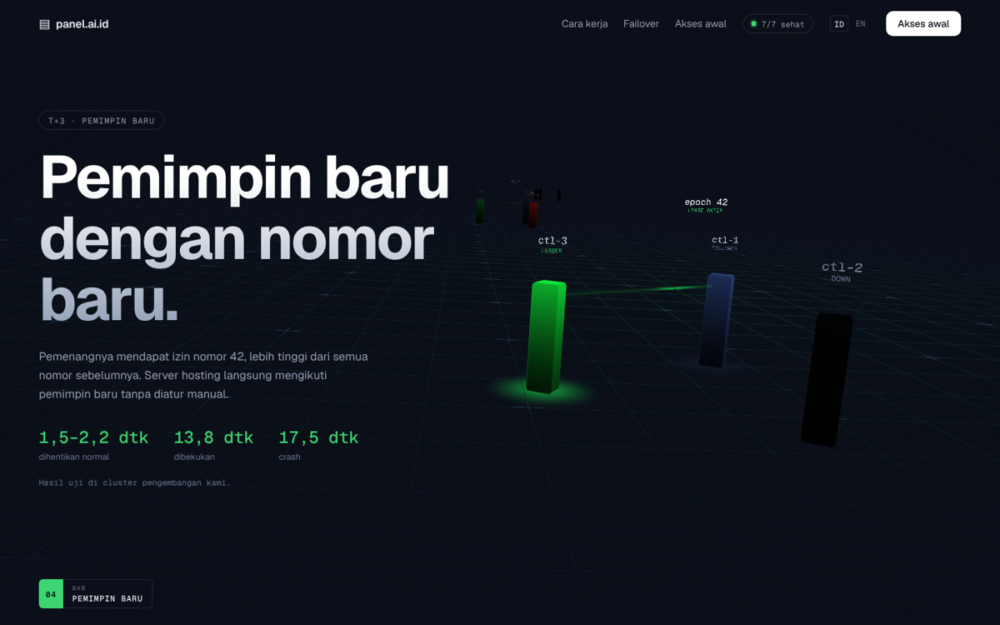

# Landing page panel.ai.id

Halaman arahan scroll-telling untuk [panel.ai.id](https://panel.ai.id) — panel
kontrol hosting berbasis cluster. Seluruh halaman adalah satu dunia 3D WebGL
yang dilintasi kamera, digerakkan sepenuhnya oleh posisi gulir, dan
dikompilasi menjadi **satu binari Go**.


## Gagasan utamanya

Klaim inti produk ini — *kalau satu pengendali mati, yang lain mengambil
alih* — tidak diceritakan lewat paragraf, melainkan **diperagakan**.

Tujuh bab berdiri berjajar di sepanjang lintasan kamera, masing-masing memuat
satu salinan diagram cluster yang membeku pada satu momen cerita failover.
Menggulir berarti terbang melewatinya satu per satu, jadi urutan waktu
dibentangkan menjadi urutan ruang — seperti bingkai film yang dijajar.

| Bab | Keadaan cluster |
| --- | --- |
| 00 Panel | Sehat; gugusan terlihat jauh di cakrawala |
| 01 Normal | ctl-2 memimpin, memegang izin 41 |
| 02 Gangguan | ctl-2 berhenti menjawab, tautannya meredup |
| 03 Izin habis | Tidak ada pemimpin; seluruh dunia berubah jingga |
| 04 Pemimpin baru | ctl-3 memimpin dengan izin 42 |
| 05 Kembali | ctl-2 hidup lagi, perintah epoch lamanya ditolak |
| 06 Akses awal | Kembali sehat |



Warna pijar yang menyapu grid mengikuti keadaan itu: hijau saat cluster punya
pemimpin, jingga saat izinnya habis. Keadaan sistem disampaikan lewat warna
sebelum satu kalimat pun dibaca.

## Menjalankan

Butuh Go 1.24+ dan Node 22+.

```bash
make run     # bangun frontend, tanam ke binari, jalankan
make dev     # server Vite dengan muat-ulang panas
```

Lalu buka <http://127.0.0.1:8080>.

## Mengganti isi

Seluruh naskah dan urutan bab ada di **`web/src/content.ts`**. Tiap bab
menyebut satu `fase`, dan medan itulah satu-satunya yang menghubungkan naskah
dengan dunia 3D — mesin 3D tidak memuat teks apa pun.

Naskah saat ini diambil dari panel.ai.id apa adanya, termasuk batasannya:
*masih dalam pengembangan*, dan *konsol web serta website pelanggan belum ikut
pindah otomatis*. Batasan itu sengaja dipertahankan; klaim yang melampaui apa
yang sudah diuji justru merusak kesan yang ingin dibangun halaman ini.

## Struktur

```
main.go                  titik masuk: flag, server HTTP, penutupan rapi
handler.go               penyaji aset yang ditanam, beserta aturan temboloknya
web/src/content.ts       seluruh naskah, urutan bab, dan fase cluster
web/src/ui.ts            navigasi, bab, HUD, penunjuk khusus
web/src/world/scene.ts   renderer, lintasan kamera, suasana per bab
web/src/world/grid.ts    shader bidang grid tak hingga
web/src/world/cluster.ts diagram tiga pengendali: menara, tautan, izin
web/src/world/labels.ts  label teks yang digambar ke canvas saat runtime
```

## Catatan rancangan

- **Gerak sebagai fungsi, bukan animasi.** Posisi kamera, warna pijar, dan
  kabut semuanya fungsi murni dari kemajuan gulir 0..1, jadi menggulir naik
  menempuh lintasan yang sama persis. Tidak ada pustaka animasi di lapisan 3D.
- **Tema tidak dibalik.** Merek panel.ai.id gelap sepenuhnya; membalikkannya ke
  putih akan terasa keluar dari identitasnya. Yang berubah mengikuti cerita
  adalah warna pijar, bukan terang-gelapnya.
- **Tanpa satu pun berkas gambar.** Label simpul digambar ke `<canvas>` saat
  runtime, setelah font selesai dimuat — kalau tidak, label terkunci memakai
  monospace bawaan sistem.
- **Kabut dihitung manual di shader.** `ShaderMaterial` tidak mewarisi
  `scene.fog`; tanpa itu menara yang jauh tetap pekat dan terbaca sebagai
  gerombolan yang mengambang.
- **Tetap utuh tanpa WebGL.** Kanvas disembunyikan dan isi tetap lengkap
  terbaca. `prefers-reduced-motion` mematikan penghalusan gulir, gerak
  menganggur, dan penunjuk khusus.

## Membuat yang serupa

`docs/prompt-ulang.md` memuat prompt siap pakai untuk membangun situs bergaya
sama di repositori lain, lengkap dengan daftar jebakan yang ditemui saat
membangun yang ini.

## Riwayat

Repositori ini pernah berisi **Pelacak Habit** (Go + SQLite) dan sebuah situs
studio contoh. Keduanya masih utuh di riwayat git:

```bash
git log --oneline
git checkout <commit> -- .
```

## Lisensi

MIT
