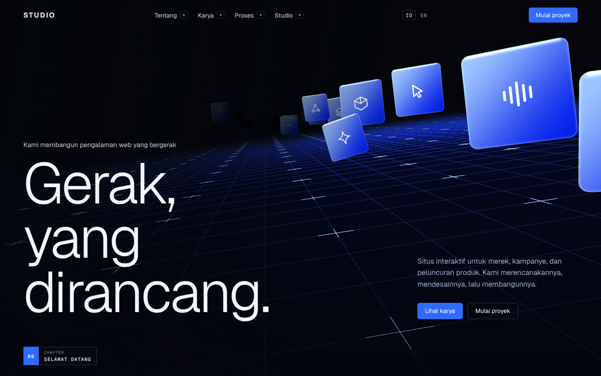

# Situs bermotion

Situs scroll-telling dengan dunia 3D WebGL yang digerakkan sepenuhnya oleh
posisi gulir. Dikompilasi menjadi **satu binari Go** berisi seluruh HTML, CSS,
JavaScript, dan font — memasangnya cukup menyalin satu berkas.



## Yang membuatnya bergerak

- **Satu dunia 3D berkelanjutan.** Bidang grid tak hingga dengan penanda `+`,
  digambar lewat shader dalam koordinat dunia, bukan tekstur — jadi tetap tajam
  pada jarak berapa pun dan tidak pernah terlihat berulang.
- **Kamera digerakkan gulir.** Posisi kamera adalah fungsi murni dari kemajuan
  gulir 0..1. Menggulir mundur selalu menghasilkan kerangka yang persis sama;
  tidak ada keadaan tersembunyi yang bisa melenceng.
- **Pembalikan tema.** Dunia berbalik dari hitam ke putih saat masuk bab Karya,
  dan warna antarmuka ikut dicampur agar teks tetap terbaca sepanjang peralihan.
- **Tile mengkilap tanpa aset.** Glif digambar ke `<canvas>` saat runtime, jadi
  tidak ada satu pun berkas gambar yang perlu dimuat atau dipaket.
- **Gulir halus** lewat Lenis, dan penunjuk tetikus khusus yang membesar di atas
  elemen yang bisa ditekan.

## Menjalankan

Butuh Go 1.24+ dan Node 22+.

```bash
make run
```

Lalu buka <http://127.0.0.1:8080>.

Untuk mengembangkan tampilan dengan muat-ulang panas:

```bash
make dev
```

### Opsi

| Flag    | Bawaan           | Keterangan    |
| ------- | ---------------- | ------------- |
| `-addr` | `127.0.0.1:8080` | Alamat dengar |

## Mengganti isi

Seluruh naskah berkumpul di **`web/src/content.ts`** — judul, paragraf, nama
bab, tema tiap bab, dan glif yang melayang di dalamnya. Mesin 3D tidak memuat
teks apa pun, jadi menambah atau menata ulang bab cukup dilakukan di berkas itu.

Naskah yang ada sekarang masih berupa contoh untuk sebuah studio. Gantilah
dengan isi aslimu.

## Struktur

```
main.go                 titik masuk: flag, server HTTP, penutupan rapi
handler.go              penyaji aset yang ditanam, beserta aturan temboloknya
web/src/content.ts      seluruh naskah dan data bab
web/src/main.ts         perekat: gulir, dunia 3D, antarmuka
web/src/ui.ts           navigasi, bab, HUD, penunjuk khusus
web/src/world/scene.ts  renderer, lintasan kamera, peralihan tema
web/src/world/grid.ts   shader bidang grid tak hingga
web/src/world/tiles.ts  tile mengkilap yang melayang
web/src/world/glyphs.ts ikon yang digambar ke canvas saat runtime
```

## Catatan rancangan

- **Gerak sebagai fungsi, bukan animasi.** Tidak ada pustaka animasi di lapisan
  3D. Sikap kamera dicampur dari beberapa titik acuan per bab, sehingga setiap
  kerangka bisa dihitung ulang dari satu angka saja.
- **Kabut dihitung sendiri di shader tile.** `ShaderMaterial` tidak mewarisi
  `scene.fog`; tanpa perhitungan manual, tile jauh tetap pekat dan terbaca
  sebagai gerombolan yang mengambang alih-alih larut ke kejauhan.
- **Peredup tepi.** Judul berukuran besar bisa jatuh tepat di atas tile terang,
  jadi tepi kiri dan bawah diberi gradien tipis berwarna latar. Tile juga
  sengaja dicondongkan menjauhi kolom teks.
- **Tetap utuh tanpa WebGL.** Kalau peramban tidak sanggup membuat konteks
  WebGL, kanvas disembunyikan dan situs tetap lengkap terbaca. `prefers-reduced-motion`
  mematikan penghalusan gulir, gerak menganggur, dan penunjuk khusus.

## Riwayat

Repositori ini sebelumnya berisi **Pelacak Habit**, aplikasi web Go + SQLite.
Kodenya tidak hilang — masih utuh di riwayat git:

```bash
git log --oneline            # cari commit "Pelacak habit"
git checkout <commit> -- .   # ambil kembali seluruh berkasnya
```

## Lisensi

MIT
