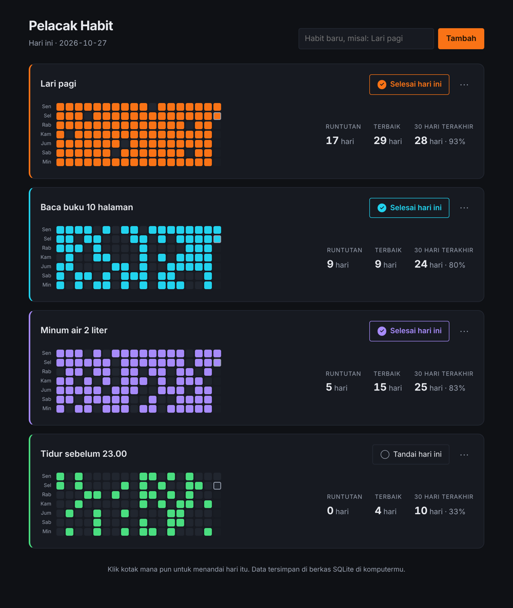

# Pelacak Habit

Aplikasi web untuk melacak kebiasaan harian, ditulis dengan Go dan SQLite.
Seluruh antarmuka ditanam ke dalam binari, jadi hasil akhirnya **satu berkas
yang bisa dijalankan** — tanpa Node, tanpa `node_modules`, tanpa server
terpisah.



## Fitur

- **Grid riwayat 18 minggu** per habit, satu kolom untuk tiap minggu.
- **Runtutan berjalan dan runtutan terbaik**, dihitung dari seluruh riwayat.
- **Tingkat penyelesaian 30 hari terakhir** dalam jumlah hari dan persen.
- Klik kotak mana pun untuk menandai hari itu — tanpa memuat ulang halaman.
- Tambah, ganti nama, dan hapus habit.
- Mode gelap dan terang mengikuti setelan sistem; tata letak menyesuaikan ponsel.
- Data tersimpan di satu berkas SQLite di komputermu sendiri.

## Menjalankan

Butuh Go 1.24 atau yang lebih baru.

```bash
go run .
```

Lalu buka <http://127.0.0.1:8080>.

Untuk membuat satu binari yang bisa disalin ke mana saja:

```bash
make build     # atau: go build -o habit .
./habit
```

### Opsi

| Flag    | Bawaan           | Keterangan                       |
| ------- | ---------------- | -------------------------------- |
| `-addr` | `127.0.0.1:8080` | Alamat dengar                    |
| `-db`   | `habits.db`      | Jalur berkas basis data SQLite   |

```bash
./habit -addr 127.0.0.1:9000 -db ~/data/habits.db
```

Secara bawaan server hanya mendengar di `127.0.0.1`, jadi tidak terbuka ke
jaringan. Aplikasi ini **tidak punya autentikasi**: aplikasi ini dirancang
untuk satu pengguna di komputer sendiri. Kalau kamu mengubah `-addr` menjadi
`0.0.0.0`, taruh di belakang proksi yang menangani autentikasi.

## Pengembangan

```bash
make test      # go test -race ./...
make lint      # gofmt + go vet
```

## Struktur

```
main.go                     titik masuk: flag, server HTTP, penutupan rapi
internal/habit/             model domain dan perhitungan statistik (murni, tanpa I/O)
internal/store/             penyimpanan SQLite
internal/web/               handler HTTP
internal/web/templates/     template HTML (ditanam ke binari)
internal/web/static/        CSS dan JavaScript (ditanam ke binari)
```

Pembagiannya mengikuti satu aturan: **`internal/habit` tidak tahu apa-apa soal
basis data maupun HTTP.** Perhitungan runtutan — bagian yang paling mudah salah —
jadi bisa dites langsung tanpa menyiapkan basis data atau server.

## Catatan rancangan

- **Driver SQLite murni Go.** `modernc.org/sqlite` tidak butuh cgo, jadi hasil
  kompilasi tetap satu binari dan kompilasi silang tetap mudah.
- **Runtutan tidak putus karena hari ini belum ditandai.** Hitungan dimulai dari
  kemarin kalau hari ini masih kosong; hari yang sedang berjalan belum berakhir.
- **Server yang menggambar halaman.** JavaScript hanya menghindari muat ulang
  saat menandai hari. Menambah, mengganti nama, dan menghapus habit tetap bekerja
  tanpa JavaScript.
- **Satu kueri untuk seluruh grid.** Catatan harian untuk semua habit diambil
  sekali lewat `EntriesRange`, bukan satu kueri per habit.

## Lisensi

MIT
